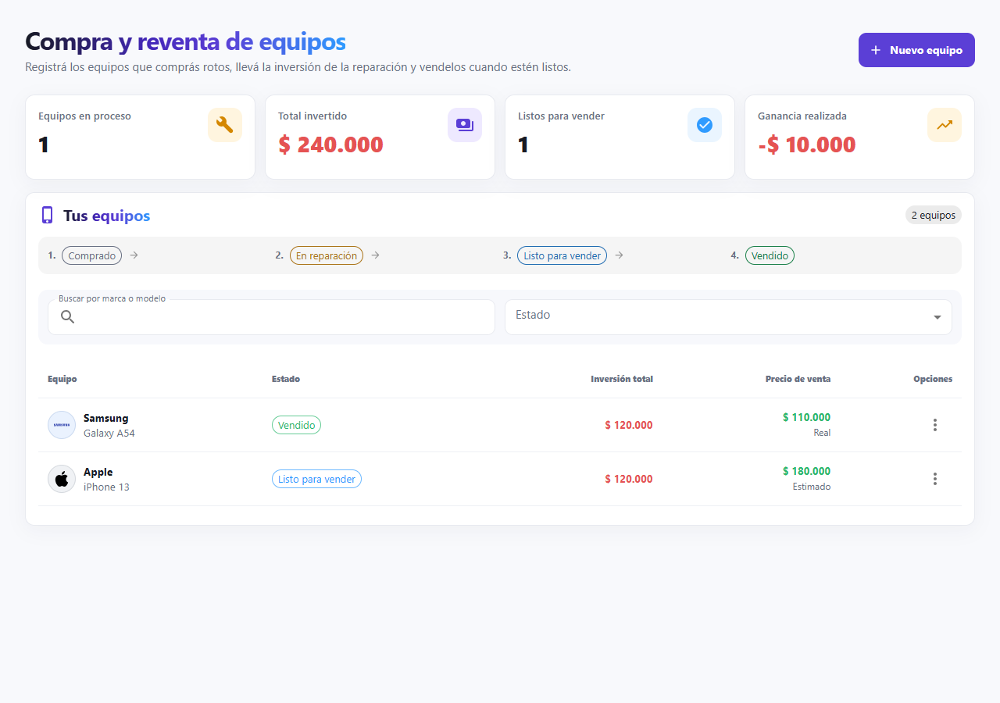
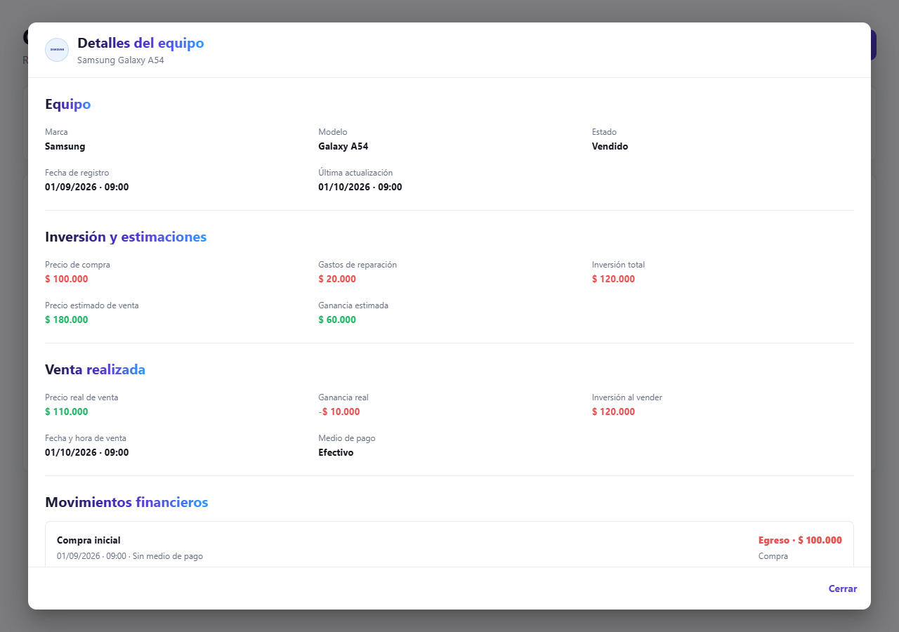
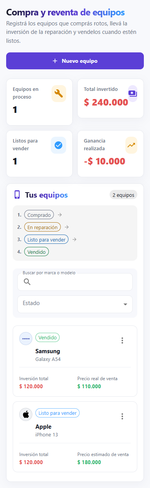
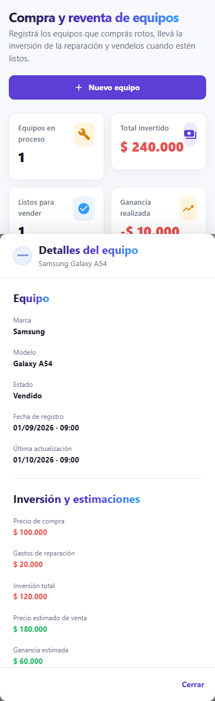
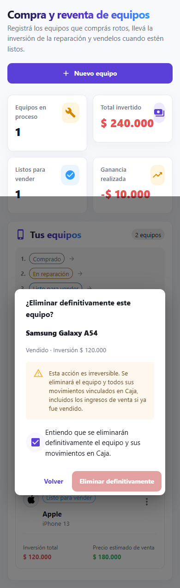
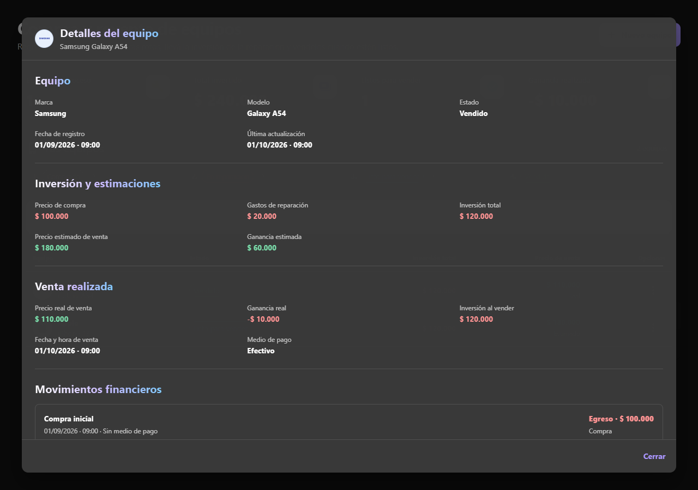

# TecnoDesk — Reventa y eliminación definitiva de equipos

Rama: `codex/equipment-resale-details-delete`. Base: `origin/main` `5841e3bf04c0f91c593781f8a1fe035b81a4ca1f`.

## Resultado

Tabla de cinco columnas, tarjetas compactas móviles, búsqueda/estado/paginación, menú disponible también para vendidos y modal grande con scroll. El detalle distingue estimaciones de venta real y muestra exclusivamente los datos guardados y movimientos del equipo. Egresos y pérdidas rojos; ingresos y ganancias verdes; títulos adaptados a tema oscuro.

Nuevo GET /api/equipment-sales/:id y DELETE /api/equipment-sales/:id. La eliminación exige autenticación, taller, permiso equipmentSales.delete, expectedVersion y confirmed:true. OWNER recibe el permiso como los demás; un técnico necesita asignación explícita en Equipo de trabajo.

DELETE bloquea el equipo y sus movimientos con FOR UPDATE. Inspecciona todas las filas vinculadas por resaleDeviceId, rechaza otros talleres, orígenes o referencias a reparaciones, Comercio, pagos y garantías. Borra primero movimientos y luego equipo en una transacción ReadCommitted. Edición/venta conservan CAS y adquieren el bloqueo mediante sus actualizaciones. Versiones obsoletas y carreras terminan en 404/409 sin borrado parcial. No genera compensaciones ni modifica inventarios.

Al eliminar físicamente las filas, las consultas existentes de Caja, resumen de equipos, dashboard, gráficos y reportes recalculan sus totales. La interfaz vuelve a consultar lista/resumen y corrige la página al quedar vacía, conservando filtros.

## Verificación local

- Backend typecheck y build aprobados.
- npm test: registro de rutas, origen, identidad de cliente y seguridad de tracking aprobados.
- npm run test:equipment-delete aprobado: esquema/migraciones de main en PostgreSQL desechable; creación/ajustes/ventas existentes, timestamps y eliminación de los cuatro estados (incluido SOLD), costos cero, ajustes positivos/negativos, ausencia física de movimientos, balances/resúmenes/dashboard/reportes iguales a su baseline.
- Borrado doble y concurrente con edición/venta, versión obsoleta, confirmación inválida, técnico sin permiso, técnico con permiso exclusivo, otros talleres y referencias compartidas: aprobados. Rollback tras fallo forzado tanto después del helper como entre el borrado efectivo de Caja y el del equipo conserva exactamente equipo y movimientos. Fixtures reales de Comercio/stock/reparaciones/pagos ajenos permanecen iguales.
- tenant-isolation-complete: 355 comprobaciones HTTP aprobadas, snapshots y dos talleres independientes.
- role-permissions-complete: 289 comprobaciones HTTP aprobadas; permiso específico requerido incluso con todos los demás concedidos.
- equipment-sales-timestamps SQLite y equipment-sales-sqlite aprobados.
- Frontend typecheck/build, equipment-sales, equipment-details-delete, cash-groups, repair-flow, repair-edit, repair-hard-delete y encoding aprobados.
- Navegador real Chrome con API simulada y tráfico externo bloqueado: desktop 1280x900, móvil 390x844 y tema oscuro; cinco columnas/sin overflow, acciones READY/SOLD, modal, confirmación y payload de borrado, desaparición del equipo y actualización del resumen; técnico de lectura sólo puede ver detalles. Capturas en screenshots/equipment-sales.
- Revisión independiente del código: sin defectos de seguridad/integridad pendientes.

Los dos intentos iniciales del runner de navegador terminaron sin comprobaciones y no se contabilizaron. Se añadió watchdog para fallar explícitamente si no completa. Una aserción móvil contaba etiquetas detrás del modal; se acotó al diálogo. La primera comprobación de TypeScript detectó declaraciones duplicadas durante la implementación y se corrigieron antes de la verificación final.

## Migraciones y límites

No se modifican Prisma ni migraciones. El esquema de main ya contiene version y las claves foráneas requeridas. La cadena existente se aplicó solamente a una base local creada por el harness. Se verificó su correspondencia con Prisma descontando únicamente el default preexistente de Client.updatedAt documentado por el harness; no se cambia ese default.

No se consultó ni modificó Supabase productivo. No se hizo merge ni despliegue. Vercel conserva sus reglas existentes y se agrega solamente deploymentEnabled:false para esta rama, evitando previews; no se modifica configuración mediante API. Render mantiene previews desactivados; commit/PR indican skip para evitar publicaciones. Las otras ramas y worktrees, incluidos cambios sin commit, quedan preservados.

Pendiente: revisión del PR y autorización separada para integrar/publicar. Frontend requiere backend actualizado para los dos endpoints nuevos. El borrado es irreversible; historial inconsistente produce 409 y requiere revisión explícita. El build conserva la advertencia existente de chunks mayores de 500 kB.

## Archivos

- .github/workflows/ci.yml
- backend/package.json
- backend/src/config/permissions.ts
- backend/src/modules/equipment-sales/equipment-sales.routes.ts
- backend/src/modules/equipment-sales/equipment-sales.service.ts
- backend/tests/equipment-sales-timestamps.ts
- backend/tests/fixtures/route-registration.json
- backend/tests/role-permissions-complete.ts
- backend/tests/tenant-isolation-complete.ts
- frontend/package.json
- frontend/src/auth/permissions.ts
- frontend/src/features/equipmentSales/EquipmentDeviceList.tsx
- frontend/src/features/equipmentSales/EquipmentSalesPage.tsx
- frontend/src/pages/TeamPage.tsx
- frontend/src/services/equipmentSales.ts
- frontend/tests/equipment-sales.cjs
- frontend/vercel.json
- backend/tests/equipment-delete.ts
- docs/screenshots/equipment-sales/dark-delete.png
- docs/screenshots/equipment-sales/dark-details.png
- docs/screenshots/equipment-sales/dark-list.png
- docs/screenshots/equipment-sales/desktop-delete.png
- docs/screenshots/equipment-sales/desktop-details.png
- docs/screenshots/equipment-sales/desktop-list.png
- docs/screenshots/equipment-sales/mobile-delete.png
- docs/screenshots/equipment-sales/mobile-details.png
- docs/screenshots/equipment-sales/mobile-list.png
- docs/superpowers/plans/2026-10-12-equipment-resale-details-delete.md
- frontend/src/features/equipmentSales/EquipmentDialogs.tsx
- frontend/tests/equipment-browser.cjs
- frontend/tests/equipment-browser.html
- frontend/tests/equipment-browser.tsx
- frontend/tests/equipment-details-delete.cjs
- docs/equipment-resale-details-delete-report.md

## Capturas

